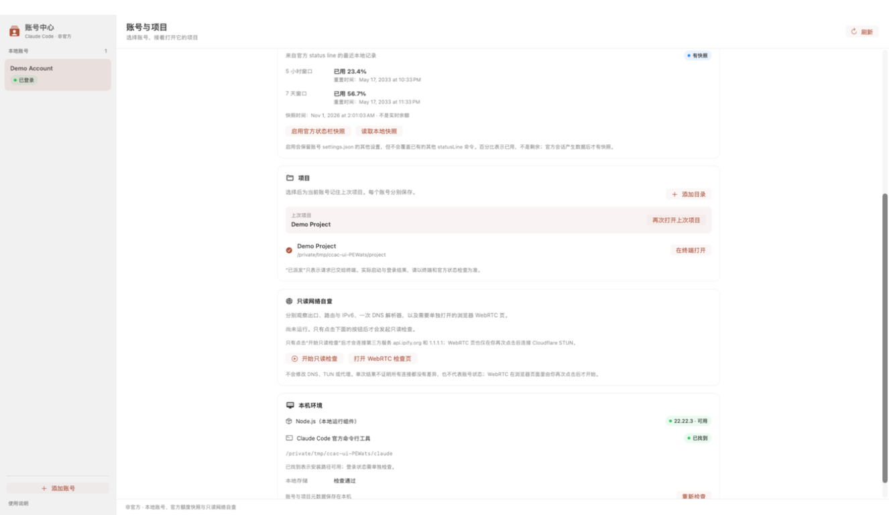

# Claude Code Account Center

**Unofficial. Not affiliated with Anthropic.**

Claude Code Account Center is an unofficial, local macOS launcher for people who use the official Claude Code CLI on an Apple Silicon Mac. It keeps more than one Claude.ai login on the same computer by giving each login its own configuration directory. Anthropic does not make, ship, support, or endorse this project.

[中文说明在下方。](#中文)

User guide: [Online guide](https://xiaohe-sz.github.io/claude-code-account-center/guide.html) · [Repository file](guide.html) · [Security](SECURITY.md) · [Privacy](PRIVACY.md) · [Troubleshooting](TROUBLESHOOTING.md) · [License](LICENSE)

Source repository: <https://github.com/xiaohe-sz/claude-code-account-center>

Current release: [v0.1.0](https://github.com/xiaohe-sz/claude-code-account-center/releases/tag/v0.1.0) · [Apple Silicon DMG](https://github.com/xiaohe-sz/claude-code-account-center/releases/download/v0.1.0/Claude-Code-Account-Center-0.1.0-macos-arm64.dmg) · [SHA-256 checksums](https://github.com/xiaohe-sz/claude-code-account-center/releases/download/v0.1.0/SHA256SUMS.txt)

## What this repository does

Version 0.1.0 is a local SwiftUI window plus a local Node.js core. The window provides account creation, official-login dispatch and status checks, project launch, optional official status-line quota snapshots, and user-initiated read-only network observations. The repository tests cover the local core and its public JSON contract.



*Demonstration only / 隔离演示数据：不包含真实账号、凭据或出口地址。*

- **One configuration directory per account.** Each account gets a private directory. When the official CLI is started for that account, the child environment sets `CLAUDE_CONFIG_DIR` to that directory and removes other `CLAUDE_*` and `ANTHROPIC_*` overrides for that process. The Mac-wide default Claude configuration is left alone. Nothing rewrites your shell profile, and nothing switches accounts by itself.
- **Official login, with no extra login flags.** A login opens Terminal and runs the official CLI as `auth login`. The launcher does not add login flags, does not ask you to paste a token, and does not complete the browser login for you. Sign-in stays on the official CLI and the official site.
- **Projects, including the last one.** A project is a local directory. Selecting a project for an account stores it as that account's last project. A launch uses the directory you picked, or that last project when you do not pick one. If the account has no last project, launch stops. A launch that starts the official CLI stores the project it started. A launch that stops because the account is not ready leaves the previous memory unchanged.
- **Quota is an optional official status-line snapshot, never a live usage API.** You can explicitly configure the documented Claude Code [status line](https://code.claude.com/docs/en/statusline) for one account. The launcher preserves other settings and refuses to overwrite a different existing `statusLine` command. Once the official CLI supplies rate-limit windows, the local snapshot can show the two used percentages and their reset times. A missing window, an expired reset, or no snapshot stays **unknown**. Unknown is not zero and not a live balance.
- **Network self-check is four user-initiated read-only observations.** Clicking the check observes exit address, route and IPv6, and one DNS resolver response. The fourth layer is a browser WebRTC page that runs only after you open it and click its own start button. Each layer can only be `pass`, `issue`, or `unverified`. A failed or unfinished observation is `unverified`, not a pass. Details are in the [user guide](guide.html).

A `pass` describes one finished observation. It is not a statement about account standing, later lookups, or other programs.

## Install the release

You need macOS 13 or newer on Apple Silicon (`arm64`), Node.js 20 or newer from <https://nodejs.org/>, and the official Claude Code CLI installed with [Anthropic's instructions](https://code.claude.com/docs/en/quickstart). The app does not install Node.js or the official CLI for you.

1. Download the [Apple Silicon DMG](https://github.com/xiaohe-sz/claude-code-account-center/releases/download/v0.1.0/Claude-Code-Account-Center-0.1.0-macos-arm64.dmg) from [v0.1.0](https://github.com/xiaohe-sz/claude-code-account-center/releases/tag/v0.1.0). The release also includes [SHA-256 checksums](https://github.com/xiaohe-sz/claude-code-account-center/releases/download/v0.1.0/SHA256SUMS.txt).
2. Open the DMG and drag **Claude Code Account Center** into **Applications**.
3. Open the app from Applications.

The release has a local ad-hoc signature, not a Developer ID signature or Apple notarization. macOS can show a warning. Read [Apple's explanation](https://support.apple.com/en-us/102445); this project does not recommend disabling Gatekeeper or removing quarantine attributes. You can build from source instead.

A graphical app does not always inherit the PATH from your shell profile. If the window cannot find Node.js, set `CCAC_NODE_PATH` to the absolute path of a Node.js 20 binary. If the official CLI is not on the default search path, set `CLAUDE_CODE_CLI` to its absolute path. See [Troubleshooting](TROUBLESHOOTING.md).

### Build from source instead

You also need Apple's Xcode Command Line Tools so `swiftc` is available. This repository has no npm dependencies. From the repository root:

```sh
npm test
npm run build
open "dist/Claude Code Account Center.app"
```

`npm test` runs `node --test Tests/*.test.mjs`. `npm run build` runs `Scripts/build-app.sh` and leaves the app at `dist/Claude Code Account Center.app`.

## Signature

The build script applies a local ad-hoc signature (`codesign --sign -`) and then checks that signature. The published DMG was built and checked the same way. This is not a Developer ID signature, and it is not Apple notarization.

macOS can warn about an app that has no Developer ID and no notarization. This repository does not include instructions for turning off Gatekeeper or for stripping quarantine attributes. Read [Apple's own explanation](https://support.apple.com/en-us/102445), or build the app yourself from this source.

## Safety boundaries

- The launcher does not read official credential files, save tokens, or relay Claude.ai sessions. The documented `auth status --json` response is parsed in memory; only allowlisted status fields reach the window, and the raw response is not persisted. Login text stays in the official CLI inside Terminal.
- It does not change the default account for the whole Mac, and it does not switch accounts automatically.
- It does not change system DNS, TUN, or proxy settings. Existing proxy variables in the environment are not deleted.
- It does not promise anything about account limits, blocks, or enforcement. It does not bypass macOS permissions or the official login.
- Before a project launch, the core asks the official CLI for authentication status. The account is ready only for a logged-in `claude.ai` session. When that status includes a configuration directory, it has to be this account's directory. When both a stored expected email and a status email are present, they have to match. Other authentication methods are not launched.
- Finding `claude` on disk is not an authenticity check. Install the official CLI yourself.
- Published screenshots must use demonstration data. Do not publish a real email, token, session, log, or home-directory path. The included screenshot uses an isolated demonstration account and temporary paths.

## Author

The author, xiaohe-sz, is a front-line real-estate agent in Shenzhen, can help with Shenzhen home-buying questions, and also writes down AI programming practice that is already in use. This repository does not add other contact details.

## License

[MIT](LICENSE). Copyright (c) 2026 xiaohe-sz.

---

## 中文

**非官方。与 Anthropic 没有隶属关系，也没有得到 Anthropic 的背书。**

Claude Code Account Center 是一个在本机运行的 macOS 启动器，给已经在用官方 Claude Code 命令行的人准备。它运行在 Apple Silicon（苹果自研芯片，M 系列）的 Mac 上。每个人在官方 CLI（命令行程序）里登录的 Claude.ai 账号，都可以有自己单独的配置目录。Anthropic 不开发、不发布、不支持、也不认可这个项目。

使用说明：[在线指南](https://xiaohe-sz.github.io/claude-code-account-center/guide.html) · [仓库里的指南](guide.html) · [安全](SECURITY.md) · [隐私](PRIVACY.md) · [故障排查](TROUBLESHOOTING.md) · [许可证](LICENSE)

源码仓库：<https://github.com/xiaohe-sz/claude-code-account-center>

当前发布：[v0.1.0](https://github.com/xiaohe-sz/claude-code-account-center/releases/tag/v0.1.0) · [Apple Silicon DMG](https://github.com/xiaohe-sz/claude-code-account-center/releases/download/v0.1.0/Claude-Code-Account-Center-0.1.0-macos-arm64.dmg) · [SHA-256 校验文件](https://github.com/xiaohe-sz/claude-code-account-center/releases/download/v0.1.0/SHA256SUMS.txt)

## 这个仓库现在做什么

0.1.0 版是一个本地 SwiftUI 窗口，加上一个本地 Node.js 核心。窗口可以添加账号、派发官方登录并检查状态、打开项目、配置官方状态栏额度快照，以及在你点击后进行只读网络观察。仓库测试覆盖本地核心和公开 JSON 协议。

- **每个账号一个配置目录。** 每个账号有自己的私有目录。为这个账号启动官方 CLI 时，子进程的环境变量 `CLAUDE_CONFIG_DIR` 会指向该目录，并清掉这个进程里其他 `CLAUDE_*` 和 `ANTHROPIC_*` 覆盖项。整台 Mac 的默认 Claude 配置保持不动。它不改写 shell 配置文件，也不会自己换账号。
- **官方登录，不加额外登录参数。** 登录会打开 Terminal（终端），只运行官方 CLI 的 `auth login`。启动器不加登录参数，不要求你粘贴令牌，也不替你完成浏览器里的登录。登录仍然由官方 CLI 和官方网站完成。
- **项目，以及上次项目。** 项目就是本机的一个目录。为一个账号选中项目时，会把该项目记成这个账号的上次项目。开工使用你这次选中的目录；没有另选时，使用上次项目。如果还没有上次项目，开工会停下来。开工如果已经启动官方 CLI，会记下这次启动的项目。因为账号还没准备好而停下时，原来记住的项目保持不变。
- **额度是可选的官方 status line 快照，不是实时额度接口。** 你可以明确选择为某个账号配置官方 Claude Code [status line](https://code.claude.com/docs/en/statusline)（状态栏：官方 CLI 在会话里刷新的一行本机状态）。启动器保留其他设置，也不会覆盖已有的其他 `statusLine` 命令。官方 CLI 提供限额窗口后，本地快照可以显示两个已用百分比和重置时间。窗口缺失、重置时间已过或没有快照时，结果就是**未知**。未知不是 0，也不是实时余额。
- **网络自查是你点击后才会运行的四层只读观察。** 点击检查会观察出口地址、路由与 IPv6，以及一次 DNS 解析器应答。第四层是浏览器 WebRTC 页，必须由你打开页面并再次点击开始。每一层只能是 `pass`（这次观察完成且没有看到它要检查的差异）、`issue`（这次观察完成且发现需要查看的差异）或 `unverified`（没有做成观察）。失败或未完成就是未验证，不是通过。说明见[使用指南](guide.html)。

`pass` 只描述这一次已经做完的观察。它不说明账号状态、以后的查询，或其他程序会怎样。

## 安装发布包

你需要一台 Apple Silicon（`arm64`）Mac，系统为 macOS 13 或更新版本；还需要 <https://nodejs.org/> 提供的 Node.js 20 或更新版本，以及按 [Anthropic 官方说明](https://code.claude.com/docs/en/quickstart)安装的 Claude Code CLI。这个应用不会替你安装 Node.js 或官方 CLI。

1. 从 [v0.1.0](https://github.com/xiaohe-sz/claude-code-account-center/releases/tag/v0.1.0) 下载 [Apple Silicon DMG](https://github.com/xiaohe-sz/claude-code-account-center/releases/download/v0.1.0/Claude-Code-Account-Center-0.1.0-macos-arm64.dmg)。同一个发布页也提供 [SHA-256 校验文件](https://github.com/xiaohe-sz/claude-code-account-center/releases/download/v0.1.0/SHA256SUMS.txt)。
2. 打开 DMG，把 **Claude Code Account Center** 拖进 **Applications（应用程序）**。
3. 从「应用程序」打开它。

发布包只有本机 ad-hoc 签名，没有 Developer ID 签名，也没有 Apple 公证，macOS 可能显示警告。请读 [Apple 自己的说明](https://support.apple.com/en-us/102445)；本项目不建议关闭 Gatekeeper 或删除隔离属性。你也可以选择自己从源码构建。

图形应用不一定能继承 shell 配置文件里的 PATH（命令搜索路径）。窗口找不到 Node.js 时，把 `CCAC_NODE_PATH` 设成 Node.js 20 可执行文件的绝对路径。官方 CLI 不在默认搜索路径上时，把 `CLAUDE_CODE_CLI` 设成它的绝对路径。见[故障排查](TROUBLESHOOTING.md)。

### 也可以从源码构建

另外需要 Apple 的 Xcode Command Line Tools（命令行开发工具），这样才有 `swiftc`。这个仓库没有 npm 依赖包。在仓库根目录执行：

```sh
npm test
npm run build
open "dist/Claude Code Account Center.app"
```

`npm test` 实际运行 `node --test Tests/*.test.mjs`。`npm run build` 运行 `Scripts/build-app.sh`，应用出现在 `dist/Claude Code Account Center.app`。

## 签名

构建脚本只做本机 ad-hoc 签名（临时自签名：`codesign --sign -`），然后检查这个签名还在。发布的 DMG 也用同样方式构建和检查。这不是 Developer ID（苹果发给开发者的签名身份），也不是 Apple 公证。

没有 Developer ID、也没有公证的应用，macOS 可能会报警。本仓库不写关闭 Gatekeeper（系统对未识别开发者的拦截）或去掉隔离属性的步骤。请读 [Apple 自己的说明](https://support.apple.com/en-us/102445)，或者自己用这份源码构建。

## 安全边界

- 启动器不读取官方凭据文件，不保存令牌，也不中转 Claude.ai 会话。官方文档规定的 `auth status --json` 状态响应只在本机内存解析；窗口只收到允许列出的状态字段，原始响应不会落盘。登录过程的文字留在 Terminal 里的官方 CLI 中。
- 它不把整台 Mac 的默认账号换掉，也不会自动换号。
- 它不修改系统 DNS、TUN（虚拟网卡隧道）或代理设置。环境里已经存在的代理变量不会被删掉。
- 它不对账号限额、限制或平台处理做承诺。它不绕过 macOS 权限，也不代替官方登录。
- 开工前，核心会向官方 CLI 查询认证状态。只有已登录的 `claude.ai` 会话才算准备好。状态里如果带了配置目录，它必须是这个账号的目录。存过的预期邮箱和状态里的邮箱都有值时，两者必须一致。其他认证方式不会被拿来开工。
- 在磁盘上找到 `claude` 不等于核验过它的真伪。请自行安装官方 CLI。
- 公开截图只能使用演示数据。不要公开真实邮箱、令牌、会话、日志或个人家目录路径。仓库里的截图使用隔离演示账号和临时目录。

## 作者

作者 xiaohe-sz 是深圳一线房产中介，可以提供深圳购房咨询，同时把已经在用的 AI 编程实践和技术写出来。本仓库不另写其他联系方式。

## 许可证

[MIT](LICENSE)。Copyright (c) 2026 xiaohe-sz。
